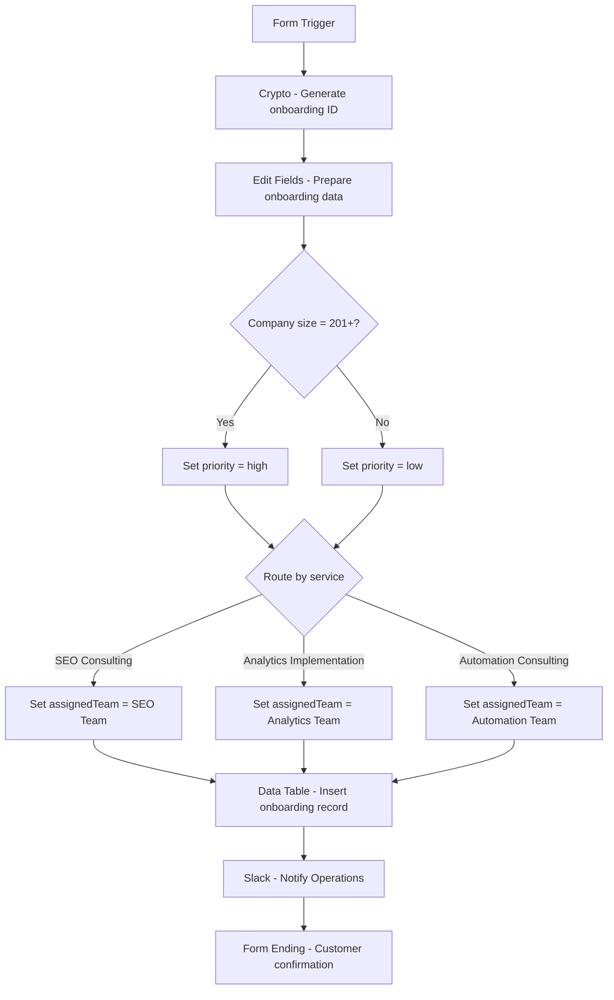

Client Onboarding Implementation

## Project Overview

This project demonstrates implementation-engineer skills by turning a business onboarding request into a tested and documented n8n workflow.

The workflow receives a client onboarding form, generates a unique onboarding ID, combines and prepares form data, classifies client priority, routes the request to the correct service team, stores the onboarding record, sends a Slack notification, and returns a confirmation to the customer.

## Business Rules

- Company size `201+` → `high` priority
- All other company sizes → `low` priority
- `SEO Consulting` → `SEO Team`
- `Analytics Implementation` → `Analytics Team`
- `Automation Consulting` → `Automation Team`
- New onboarding records are stored with `status = new`
- Each submission receives a unique onboarding ID
- Required form fields must be completed before submission

## Workflow

